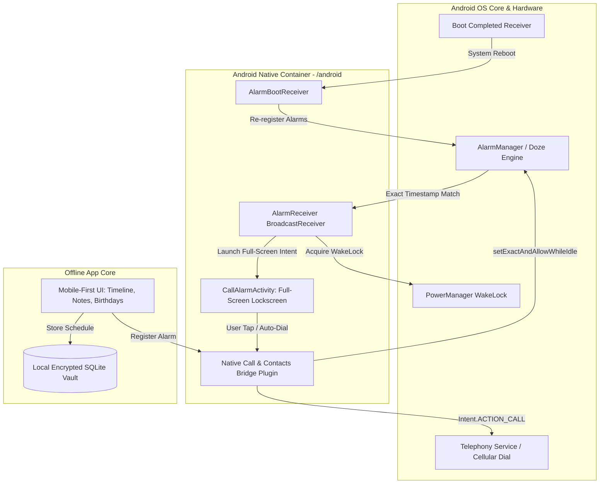

# Product Requirements Document (PRD)

## Project: **Reminder Android App (100% Offline) with Direct-Dial Call Reminders**
* **Primary Target:** Native Android APK (Release & Debug) via Automated GitHub Actions CI/CD
* **Architecture:** Mobile-First React UI bundled inside native Capacitor Android Shell with Native Telephony & Alarm Engine
* **Document Version:** 2.0.0 (APK-Focused Architecture)
* **Status:** Finalized & Ready for Scaffolding

---

## 1. Product Vision & Android Architecture

### 1.1 Core Vision
**Reminder** is a 100% offline, privacy-first Android application that combines tasks, rich notes, and birthdays with an intelligent **Direct-Dial Call Reminder Engine**. The app does not connect to the internet, requires no sign-up, and stores all user data inside an isolated local database on the Android filesystem.

### 1.2 Android Native Layer vs. UI Layer
The application operates as a **Native Android Application** where:
1. **The Native Layer (Java/Kotlin + Android Services)** handles system-level exact alarms, lockscreen wakeups, power management, device boot recovery, and direct telephony execution.
2. **The Presentation Layer (Mobile-First UI)** delivers an aesthetic, anti-slop interface optimized for single-thumb mobile operation.



---

## 2. Dedicated Android Telephony & Call Flow

### 2.1 Mother's Birthday Example Workflow
* **Entry:** User schedules "Mother" birthday (`28/11/2001`) at `08:00 AM` with phone number `+1 (555) 019-2834`.
* **Annual Exact Scheduling:** 
  Native `AlarmManager` registers an exact trigger using `setExactAndAllowWhileIdle()` for `November 28 at 08:00:00`.
* **Device Wakeup:**
  Even if the phone is asleep or in Doze mode, Android activates `AlarmReceiver`.
* **Lockscreen Alert (`CallAlarmActivity`):**
  Uses `USE_FULL_SCREEN_INTENT` with:
  ```java
  setShowWhenLocked(true);
  setTurnScreenOn(true);
  getWindow().addFlags(WindowManager.LayoutParams.FLAG_KEEP_SCREEN_ON);
  ```
  The phone rings and vibrates, presenting:
  - Caller Name: **Mother**
  - Milestone: **"Turning 24 Today! 🎂"**
  - Formatted Phone Number
  - Large Green "Call Mother Now" button + "Snooze 10m" + "Dismiss"
* **Direct Dial Execution:**
  Upon tapping call (or auto-dial countdown):
  ```java
  Intent callIntent = new Intent(Intent.ACTION_CALL);
  callIntent.setData(Uri.parse("tel:" + phoneNumber));
  callIntent.addFlags(Intent.FLAG_ACTIVITY_NEW_TASK);
  context.startActivity(callIntent);
  ```
  The call connects immediately through the cellular carrier without opening a keypad.

---

## 3. Required Android Permissions & Manifest

```xml
<manifest xmlns:android="http://schemas.android.com/apk/res/android"
    package="com.reminder.offline">

    <!-- Direct Calling -->
    <uses-permission android:name="android.permission.CALL_PHONE" />

    <!-- Exact Alarms & Wakeup from Deep Sleep -->
    <uses-permission android:name="android.permission.SCHEDULE_EXACT_ALARM" />
    <uses-permission android:name="android.permission.USE_EXACT_ALARM" />
    <uses-permission android:name="android.permission.WAKE_LOCK" />
    <uses-permission android:name="android.permission.RECEIVE_BOOT_COMPLETED" />

    <!-- Lockscreen Display & High-Priority Notifications -->
    <uses-permission android:name="android.permission.USE_FULL_SCREEN_INTENT" />
    <uses-permission android:name="android.permission.POST_NOTIFICATIONS" />
    <uses-permission android:name="android.permission.VIBRATE" />

    <!-- Native Address Book Integration -->
    <uses-permission android:name="android.permission.READ_CONTACTS" />

    <application
        android:allowBackup="false"
        android:icon="@mipmap/ic_launcher"
        android:label="Reminder"
        android:theme="@style/AppTheme">

        <!-- Boot Receiver for Persisting Alarms across Phone Reboots -->
        <receiver android:name=".AlarmBootReceiver" android:exported="true">
            <intent-filter>
                <action android:name="android.intent.action.BOOT_COMPLETED" />
                <action android:name="android.intent.action.LOCKED_BOOT_COMPLETED" />
                <action android:name="android.intent.action.TIME_SET" />
                <action android:name="android.intent.action.TIMEZONE_CHANGED" />
            </intent-filter>
        </receiver>

        <!-- Background Alarm Receiver -->
        <receiver android:name=".AlarmReceiver" android:exported="false" />

        <!-- Full-screen Incoming Call Alert Activity -->
        <activity
            android:name=".CallAlarmActivity"
            android:showWhenLocked="true"
            android:turnScreenOn="true"
            android:excludeFromRecents="true"
            android:theme="@style/Theme.FullScreenAlarm"
            android:exported="false" />
            
        <activity
            android:name=".MainActivity"
            android:configChanges="orientation|keyboardHidden|keyboard|screenSize|locale|smallestScreenSize|screenLayout|uiMode"
            android:launchMode="singleTask"
            android:theme="@style/AppTheme.NoActionBarLaunch"
            android:exported="true">
            <intent-filter>
                <action android:name="android.intent.action.MAIN" />
                <category android:name="android.intent.category.LAUNCHER" />
            </intent-filter>
        </activity>
    </application>
</manifest>
```

---

## 4. Native Plugins & Android Bridge Components

1. **`CallReminderPlugin.java`**:
   - `scheduleExactAlarm(id, timestamp, title, phoneNumber, contactName, isBirthday)`
   - `cancelAlarm(id)`
   - `directCall(phoneNumber)`: Executes `Intent.ACTION_CALL` directly
   - `openContactPicker()`: Launches `ContactsContract.CommonDataKinds.Phone` to pick contacts with one tap
   - `requestTelephonyPermissions()`: Seamlessly requests `CALL_PHONE`, `READ_CONTACTS`, and `POST_NOTIFICATIONS`

2. **`AlarmReceiver.java`**:
   - Receives alarm intent from `AlarmManager`.
   - Acquires temporary `WakeLock` to prevent the CPU from going back to sleep.
   - Posts a high-priority heads-up notification with action buttons (`Call Now`, `Snooze`).
   - Launches `CallAlarmActivity` via `PendingIntent.getActivity()` with `FLAG_ACTIVITY_NEW_TASK`.

3. **`CallAlarmActivity.java`**:
   - Displays full-screen over the lockscreen with custom ringtone and vibration.
   - Shows recipient avatar, name, birth year milestone, and single-swipe or tap action to direct-dial.

4. **`AlarmBootReceiver.java`**:
   - Triggered when the user restarts their phone.
   - Re-reads all active reminders and birthdays from the local database and re-registers them with `AlarmManager`.

---

## 5. Automated GitHub Actions CI/CD Pipeline (`build-apk.yml`)

The workflow automatically compiles an installable Android APK on push/release.

```yaml
name: Build Reminder Android APK

on:
  push:
    branches: [ main, master ]
  pull_request:
    branches: [ main, master ]
  workflow_dispatch:

jobs:
  build-apk:
    name: Build & Package Android APK
    runs-on: ubuntu-latest

    steps:
      - name: Checkout Code
        uses: actions/checkout@v4

      - name: Setup Node.js 20.x
        uses: actions/setup-node@v4
        with:
          node-version: 20
          cache: 'npm'

      - name: Setup Java JDK 17
        uses: actions/setup-java@v4
        with:
          distribution: 'temurin'
          java-version: 17

      - name: Setup Android SDK
        uses: android-actions/setup-android@v3

      - name: Install Node Dependencies
        run: npm ci

      - name: Build Web Production Assets
        run: npm run build

      - name: Sync Capacitor Android Project
        run: npx cap sync android

      - name: Set Permissions on Gradlew
        run: chmod +x android/gradlew

      - name: Compile Android Debug APK
        run: |
          cd android
          ./gradlew assembleDebug --no-daemon --stacktrace

      - name: Upload APK Artifact
        uses: actions/upload-artifact@v4
        with:
          name: Reminder-v1.0-debug-apk
          path: android/app/build/outputs/apk/debug/app-debug.apk
          retention-days: 30

      - name: Notify Build Success
        run: echo "APK build successful! Ready for installation on Android devices."
```

---

## 6. Execution Plan & Phasing

* **Step 1: Scaffolding the Core & Android Native Project**
  - Initialize the Vite React project, install Capacitor (`@capacitor/core`, `@capacitor/cli`, `@capacitor/android`).
  - Initialize the `android/` project folder with Gradle wrappers.
* **Step 2: Native Android Telephony & Scheduler Engine**
  - Implement `AlarmReceiver`, `AlarmBootReceiver`, `CallAlarmActivity`, and `CallReminderPlugin`.
  - Configure `AndroidManifest.xml` with permissions and activities.
* **Step 3: Mobile-First UI (Design Taste Anti-Slop Compliant)**
  - Implement Timeline Dashboard, Quick Call Reminder Composer, Mother's Birthday entry with age calculator, and Notes Vault.
  - Implement Full-screen Call Alarm preview and permission request cards.
* **Step 4: Offline Local Database**
  - Build the indexed, zero-cloud local storage layer for reminders, recurring birthdays, and notes.
* **Step 5: GitHub Actions Workflow Verification**
  - Implement `.github/workflows/build-apk.yml`.
  - Validate end-to-end APK compilation.
